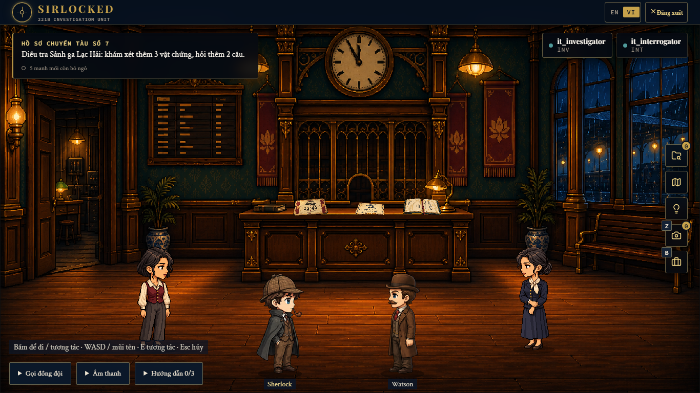

# Hồ sơ chuyến tàu số 7

Case điều tra tiếng Việt dành cho hai người, dài hơn case “Đêm khóa sổ”: **3 hồi, 6 cảnh, 5 nhân vật, 23 vật phẩm, 32 manh mối, 4 màn đối chất và 3 suy luận bắt buộc**. Thời lượng thiết kế 60–90 phút; chưa đo bằng người chơi mới. Hai thám tử tìm hồ sơ kiểm định cầu bị đổi tuyến trước giờ tàu đêm, phân biệt lời khai sai do nhầm giờ với hành vi cố ý che giấu.



Case có bộ ảnh riêng gồm **28 PNG mới**: 6 bối cảnh, 5 NPC chibi và 17 vật phẩm. 22 ảnh NPC/vật phẩm có alpha thật. JSON được tác giả soạn trong Codex, ảnh được tạo bằng ImageGen tích hợp; không dùng khóa API riêng hay endpoint AI của ứng dụng. Nhân vật người chơi và âm thanh dùng tài nguyên chung của dự án.

## Nội dung chơi

| Hồi | Bối cảnh | Công việc chính |
| --- | --- | --- |
| I — Mười hai phút bị mất | Sảnh ga, phòng điện tín | Thu hai mảnh giấy, ghép bản nháp, mở khóa số, đối chiếu nguồn giờ độc lập, đối chất và thống nhất mốc bàn giao |
| II — Bức điện chưa từng đến | Kho hành lý, buồng trực tín hiệu | Dùng chìa, chụp kiện hàng, giải khóa ký hiệu và trình tự, kiểm chứng điện đến và việc sửa đồng hồ |
| III — Người nhận cuối cùng | Lưu trữ kế toán, sân tập kết | Đọc sổ, sao vết hằn, xác lập quyền giữ hồ sơ, mở rương bản gốc, đối chất cuối và cáo buộc chung |

13 câu hỏi chính, 15 nút hội thoại với 10 nhánh hỏi thêm, câu hỏi mở theo chứng cứ, 2 vùng máy ảnh bắt buộc, 2 công thức ghép và 2 tương tác dùng chìa. Có hướng nghi ngờ sai kiểm chứng được, 19 gợi ý theo ngữ cảnh, phản hồi khi giải sai, nội dung thắng/thua và yêu cầu hai người đồng thuận. Mỗi hồi có bằng chứng mở cửa từ suy luận; không thể chỉ đọc hết NPC rồi bỏ qua phần phối hợp.

## Kết quả kiểm chứng ngày 04/10/2026

- Validator backend **PASS, 0 lỗi**, khớp SHA-256 của bản JSON đã chơi.
- **78 test backend PASS**; frontend typecheck và production build **PASS**.
- **Hai lượt chơi case mới PASS**: kết thúc thắng và cáo buộc sai dẫn tới kết thúc thua. Hai trình duyệt dùng cả hai vai trò, thao tác bằng giao diện thật.
- Lượt kiểm tra mở rộng đi qua đủ **15 nút hội thoại / 10 nhánh hỏi thêm**; cả 3 puzzle được thử sai rồi giải đúng, cặp đối chất sai không mở reveal.
- Case cũ “Đêm khóa sổ” được chạy lại: **PASS**.
- Đã xem ảnh cả 6 cảnh ở desktop và ảnh laptop cho cảnh 1/4/6; không có lỗi hình ảnh chặn chơi.
- 28 ảnh mới có checksum, 36 đường dẫn tài nguyên trực tiếp không thiếu. Build đóng gói 86 tệp tài nguyên gồm các tài nguyên chung/tham chiếu hiện có.
- Database tạm đã xóa và tiến trình thử nghiệm đã dừng; database chính chưa bị thay đổi.

Xem [verification.json](verification.json) để biết phạm vi. Ảnh [kết thúc thắng](evidence/case-closed.png) và [kết thúc thua](evidence/case-rejected.png) có spoiler. Build còn cảnh báo bundle Phaser và đường dẫn CSS của dự án; không có lỗi build. Bài test đã sửa việc đọc lịch sử hội thoại từ sai vai trò trước lượt kiểm tra cuối.

## Tệp và cách sử dụng

| Tệp | Mục đích |
| --- | --- |
| [case.json](case.json) | JSON để validate và import vào Admin |
| [build_case.py](build_case.py) | Nguồn tác giả tái tạo JSON bằng Python, không gọi dịch vụ AI |
| [SOLUTION.md](SOLUTION.md) | Timeline, đường giải và toàn bộ đáp án; có spoiler |
| [AUTHORING_GUIDE.md](AUTHORING_GUIDE.md) | Cấu trúc tham chiếu để tạo các case dài tiếp theo |
| [asset-prompts.json](asset-prompts.json) | Prompt và nguồn của từng ảnh |
| [asset-manifest.json](asset-manifest.json) | Kích thước, alpha và SHA-256 của ảnh đã tích hợp |
| [validation-report.json](validation-report.json) | Kết quả validator chính, gắn SHA-256 của JSON |
| [verification.json](verification.json) | Bằng chứng kiểm thử, phạm vi và giới hạn |
| [test-full-case.ps1](test-full-case.ps1) | Chạy hai trình duyệt trên database tạm |

Ảnh nằm tại `src/FE/public/assets/reference-cases/chuyen-tau-so-7/`. Giữ JSON và lời giải ngoài frontend `public` vì chứa đáp án. Đây là nội dung cho V3 nhập thủ công: `PLACEMENT_FIRST`, `mechanicsVersion: 3`, `logicContractVersion: 1`. Không giả lập metadata causal do dịch vụ AI sinh.

Từ thư mục gốc repository:

```powershell
dotnet run --project tools/ValidateCase -- ai-game-docs/full-case-chuyen-tau-so-7/case.json ai-game-docs/full-case-chuyen-tau-so-7/validation-report.json
node src/FE/scripts/build-cases.mjs --case ai-game-docs/full-case-chuyen-tau-so-7/case.json --report-only
```

Mở Admin → **Nhập JSON** (`/#/admin/import`), dán `case.json`, Validate rồi Import. ID mới là `case-full-chuyen-tau-so-7-vi`, trạng thái DRAFT. Sau khi xem lại, Publish để đưa vào danh sách chơi. Hai tài khoản vào cùng phòng và chọn hai vai trò khác nhau. Gói này chưa được import/publish vào database chính.

Chạy backend từ mã nguồn hiện tại: validator đã bổ sung nguồn manh mối `deduction` để kiểm tra đúng các chốt mở hồi từ suy luận. Nếu backend đang chạy bản cũ, khởi động lại sau khi build trước khi import.

Build frontend kèm tài nguyên:

```powershell
node src/FE/scripts/build-cases.mjs --case ai-game-docs/full-case-chuyen-tau-so-7/case.json --out-dir tmp/chuyen-tau-so-7-dist
```

## Kiểm thử lại

```powershell
./ai-game-docs/full-case-chuyen-tau-so-7/test-full-case.ps1
./ai-game-docs/full-case-chuyen-tau-so-7/test-full-case.ps1 -Ending loss
```

Script dùng MongoDB portable có sẵn trong `.tools/`, cổng mặc định Mongo/API/FE `27027/5327/5287`; có thể đổi bằng tham số. Database thử nghiệm riêng được xóa và tiến trình do script tạo được dừng sau lượt chơi. Không đọc kết nối database chính hoặc gọi provider AI. Log và ảnh chụp được giữ trong `tmp/` và `src/FE/test-results/`.

Test dùng đáp án đã biết để kiểm chứng runtime qua click chuột, hội thoại, túi đồ, máy ảnh, giải đố và đồng thuận hai người. Nó không đo độ khó hay mức thú vị với người chơi mới. Cần một lượt playtest người thật trước khi chốt thời lượng và cân chỉnh gợi ý.
