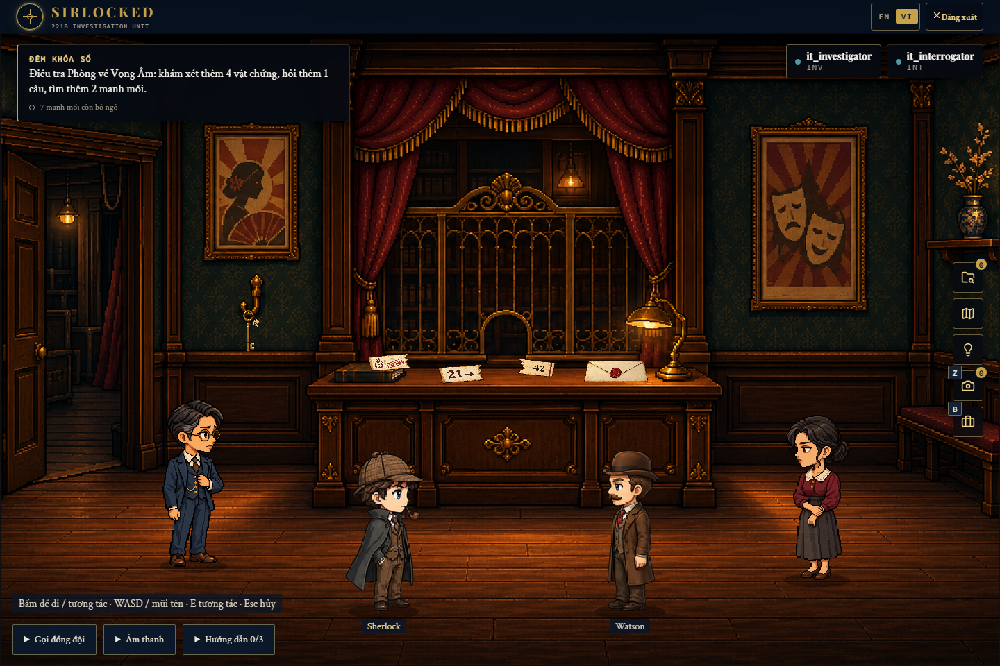

# Đêm khóa sổ — case tham chiếu SIRLOCKED

Case tiếng Việt cho hai người, thời lượng thiết kế khoảng 35 phút. Hai thám tử điều tra việc đổi lệnh chi quỹ cứu trợ tại nhà hát Vọng Âm trước giờ ngân hàng giải ngân. Đây là gói nội dung chơi được theo cơ chế V3 hiện có, dùng làm mẫu cho các case tiếp theo.



Bản **pixel-v2** làm lại toàn bộ 13 ảnh theo phong cách Sherlock/Watson của dự án. NPC và người chơi cùng tỷ lệ, spawn tách nhau, vật thể bám mặt bàn/kệ, cửa và vùng camera khớp ảnh. Renderer xếp nhân vật theo bàn chân, ẩn đồ đã nhặt/tiêu hao, chỉ hiện tên NPC khi rê chuột và thu gọn thông báo. Bản ảnh cũ được giữ tại `archive/painterly-v1`, ngoài frontend public.

## Kết quả kiểm chứng ngày 04/10/2026

- Validator chính của backend: **PASS, 0 lỗi**; SHA-256 khớp đúng bản JSON đã chơi thử.
- Tài nguyên: **PASS**, 58 tệp gồm 13 ảnh mới và tài nguyên chung, không thiếu đường dẫn.
- Frontend typecheck và production build: **PASS**. Bản build nằm ở `tmp/dem-khoa-so-pixel-dist`; JSON đáp án không có trong public build.
- **22 test backend PASS** cho ánh xạ vật phẩm và thông tin theo vai trò.
- Hai trình duyệt Chromium: **1 test PASS**, từ nhập vai đến kết quả thắng. Đã thử mã sai và cặp đối chất sai, rồi giải lại thành công; cả hai người xác nhận cáo buộc. Kiểm tra thêm vật phẩm bị tiêu hao không xuất hiện lại và ảnh cảnh ở 1440×960 / 1366×768. Không ghi nhận `pageerror` trong luồng được theo dõi.
- Database thử nghiệm đã xóa, tiến trình thử nghiệm đã dừng. Database chính không bị thay đổi.

Chi tiết máy đọc được: [verification.json](verification.json). Ảnh [hồi II](evidence/scene-2-investigator.png) và [kết quả thắng](evidence/case-closed.png) có spoiler. Nhánh kết thúc thua có nội dung hoàn chỉnh trong JSON nhưng chưa được chơi riêng đến kết quả thua. Bản build vẫn có cảnh báo kích thước bundle Phaser/tài nguyên CSS của dự án; không có lỗi build.

## Các tệp chính

| Tệp | Dùng để làm gì |
| --- | --- |
| [case.json](case.json) | JSON hoàn chỉnh để validate và import vào Admin |
| [SOLUTION.md](SOLUTION.md) | Sự thật, timeline, đường giải, cặp đối chất và đáp án; có spoiler |
| [AUTHORING_GUIDE.md](AUTHORING_GUIDE.md) | Quy tắc thiết kế và prompt để tạo case tiếp theo |
| [asset-prompts.json](asset-prompts.json) | Toàn bộ prompt đã dùng với ImageGen tích hợp trong Codex |
| [asset-manifest.json](asset-manifest.json) | Đường dẫn, kích thước, alpha, dung lượng và SHA-256 của 13 ảnh mới |
| [validation-report.json](validation-report.json) | Kết quả validator chính của backend gắn với SHA-256 của JSON |
| [build_reference.py](build_reference.py) | Nguồn tác giả để tái tạo JSON, không gọi model/API |
| [test-reference.ps1](test-reference.ps1) | Chạy hai trình duyệt với MongoDB tạm, tự dừng tiến trình sau test |

Ảnh ở `src/FE/public/assets/reference-cases/dem-khoa-so/pixel-v2/`: 2 bối cảnh, 3 nhân vật, 8 vật phẩm. Bối cảnh phòng vé cũng làm ảnh bìa. Chân dung hội thoại dùng cùng ảnh nhân vật toàn thân để giữ nhận diện. 11 ảnh nhân vật/vật phẩm có alpha thật. Nhân vật người chơi và âm thanh dùng tài nguyên chung của dự án. Ảnh được tạo mới bằng **ImageGen tích hợp**, JSON được soạn trong phiên Codex; không chạy endpoint sinh case, OpenAI API riêng, Cloudinary hay công cụ video của ứng dụng.

## Phạm vi chức năng

| Chức năng | Nội dung minh họa |
| --- | --- |
| Hai vai trò có thông tin riêng | INVESTIGATOR tìm vật chứng; INTERROGATOR thu lời khai |
| Hai hồi / hai cảnh | Phòng vé → hành lang kiểm sổ; giữ tiến độ qua chuyển hồi |
| Di chuyển và click vật thể | Vùng đi bộ, chướng ngại, vị trí NPC, điểm tương tác và cửa chuyển cảnh |
| Khám xét / nhặt đồ | Hai mảnh biên nhận, chìa, phong bì, phiếu cầm đồ |
| Máy ảnh bắt buộc | Chụp móc chìa nguyên vẹn; ảnh dùng ở đối chất thứ hai |
| Túi đồ / ghép / tiêu thụ | Ghép 21 và 42; hai mảnh bị tiêu thụ, nhận biên nhận hoàn chỉnh |
| Dùng vật trên mục tiêu | Chìa đồng mở ngăn thư; chìa được giữ lại |
| Câu đố mã có căn cứ | Mã 2142 từ biên nhận; mã sai không mở khóa |
| Hỏi và rẽ nhánh hội thoại | 3 câu hỏi chính, một gốc hội thoại và hai nhánh hỏi Khang |
| Hướng nghi ngờ sai có thể bác | Phiếu cầm đồ của Khang đã tất toán tuần trước |
| Đối chất hai người | Hai cặp lời khai–vật chứng, đề xuất rồi cả hai xác nhận |
| Phản hồi khi sai | Cặp đối chất sai không mở reveal; được thử lại |
| Suy luận và phối hợp | Một suy luận tổng hợp yêu cầu cả hai đối chất; hai chuỗi phối hợp |
| Gợi ý theo ngữ cảnh | 7 gợi ý cho cảnh, đối chất và suy luận |
| Kết luận cuối | Chọn người, động cơ, phương thức; gắn 3 chứng cứ MOTIVE/METHOD/OPPORTUNITY |
| Đồng thuận cáo buộc | Hai người xác nhận cùng một cáo buộc |
| Kết thúc | Nội dung thắng/thua riêng, được runtime tính kết quả |

Đây là chuẩn cho **luồng điều tra V3 nhập thủ công**: `PLACEMENT_FIRST`, `mechanicsVersion: 3`, `logicContractVersion: 1`. Không giả mạo metadata truth/causal do server tạo. Không bao gồm mọi biến thể câu đố, video sinh tự động, hay chế độ toàn bộ vật chứng nằm sẵn trong nền `CAMERA_EMBEDDED`.

## Đưa vào ứng dụng

Chạy các lệnh dưới đây từ thư mục gốc repository SIRLOCKED:

```powershell
dotnet run --project tools/ValidateCase -- ai-game-docs/reference-case-dem-khoa-so/case.json ai-game-docs/reference-case-dem-khoa-so/validation-report.json
node src/FE/scripts/build-cases.mjs --case ai-game-docs/reference-case-dem-khoa-so/case.json --report-only
```

1. Chạy backend và frontend của dự án như bình thường, bật gameplay V3.
2. Đăng nhập Admin, mở **Nhập JSON** tại `/#/admin/import`.
3. Dán nội dung `case.json`, Validate rồi Import. Case có ID riêng `case-reference-dem-khoa-so-vi`, trạng thái DRAFT.
4. Xem lại trong Admin; Publish khi muốn đưa vào danh sách người chơi.
5. Hai tài khoản vào cùng phòng, chọn hai vai trò khác nhau rồi bắt đầu.

Trong lượt tạo gói này không import/publish vào database chính. Các tệp JSON và lời giải phải giữ ngoài thư mục frontend `public` vì có đáp án. API Admin cũng hỗ trợ `POST /api/admin/cases/validate` và `/import-json`, body `{"caseJson": <object>, "overwrite": false}`.

Build frontend chỉ chứa tài nguyên cần cho case:

```powershell
node src/FE/scripts/build-cases.mjs --case ai-game-docs/reference-case-dem-khoa-so/case.json --out-dir tmp/dem-khoa-so-pixel-dist
```

## Kiểm thử lại

```powershell
./ai-game-docs/reference-case-dem-khoa-so/test-reference.ps1
```

Script dùng MongoDB portable có sẵn tại `.tools/mongodb-it-8.0.8/mongod.exe`, cổng Mongo/API/FE mặc định `27026/5326/5286`. Nó tạo database tên `sirlocked_it_<guid>`, chạy test point-and-click với bố cục tác giả, rồi xóa đúng database thử nghiệm và dừng tiến trình do nó tạo. Log vẫn được giữ trong `tmp/`. Nếu cổng đang được dùng, chọn ba cổng khác bằng tham số. Không đọc chuỗi kết nối database chính, không gọi dịch vụ AI.

Nếu đã có MongoDB loopback, có thể chạy trực tiếp:

```powershell
./scripts/test-v3-full-stack.ps1 -PointClick -CaseJsonPath ./ai-game-docs/reference-case-dem-khoa-so/case.json -MongoConnectionString 'mongodb://127.0.0.1:27020/?serverSelectionTimeoutMS=3000' -ApiPort 5326 -FrontendPort 5286
```

Bộ test tự động biết trước đáp án để xác minh máy game. Nó không đo được mức thú vị, độ khó thật hay việc người chơi mới có tự suy ra được lời giải. Đánh giá những điểm đó bằng playtest người thật trước khi dùng làm chuẩn chất lượng sản phẩm.
