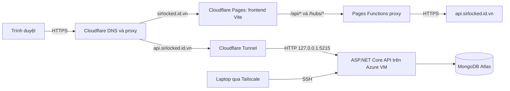

# Hướng dẫn triển khai SirLocked: Cloudflare Pages + Azure VM

Tài liệu này ghi lại cách dự án SirLocked đã được đưa lên mạng vào tháng 10/2026, từ mã nguồn đến frontend, API, tên miền và vận hành. Giao diện của các nhà cung cấp có thể thay đổi; hãy dựa vào tên chức năng và kiểm tra kết quả ở từng bước. Những tên miền, đường dẫn và tên tài nguyên bên dưới là của dự án này. **Không sao chép mật khẩu, khóa SSH, tệp bản quyền hay token tunnel vào Git hoặc tài liệu.**

## 1. Sơ đồ tổng thể



- **Frontend:** Cloudflare Pages, dự án `sirlocked-test`, nguồn GitHub `Binni1001/Sirlocked-test`, nhánh production `feature/auth-validation`.
- **Tên miền web:** `https://sirlocked.id.vn`; URL Pages dự phòng là `https://sirlocked-test.pages.dev`.
- **Backend:** Azure VM `sirlocked-api`, Ubuntu 24.04, resource group `rg-sirlocked`, vùng East Asia, .NET 9, chạy qua `systemd` trên `127.0.0.1:5215`.
- **Tên miền API:** `https://api.sirlocked.id.vn` đi qua Cloudflare Tunnel `sirlocked-api` đến API nội bộ.
- **Cơ sở dữ liệu:** MongoDB Atlas. **Truy cập quản trị VM:** SSH qua Tailscale.

> Trạng thái được xác nhận: VM và hai dịch vụ `sirlocked-api`, `cloudflared` chạy; `/health` nội bộ và `https://api.sirlocked.id.vn/health` trả `Healthy`; trang chủ `https://sirlocked.id.vn` trả HTTP 200; lời gọi `/api/auth/me` khi chưa đăng nhập trả 401 từ API. Đây là kiểm tra kết nối, **chưa phải xác nhận toàn bộ chức năng ứng dụng**.

## 2. Chuẩn bị trước khi triển khai

1. Có quyền truy cập kho GitHub chứa mã nguồn. Kho gốc thuộc bạn của chủ dự án; bản fork `Binni1001/Sirlocked-test` được dùng để kết nối Cloudflare Pages. Kiểm tra nhánh chứa **mã nguồn thực**, vì `main` của fork ban đầu chỉ có README.
2. Có tài khoản Cloudflare, tên miền `sirlocked.id.vn` tại PA Việt Nam, tài khoản Azure for Students và MongoDB Atlas.
3. Giữ riêng các bí mật: chuỗi kết nối MongoDB, mật khẩu SMTP, OAuth client secret, các khóa ứng dụng, tệp `sirlocked-api_key.pem`, tệp `sixlabors.lic` và token Cloudflare Tunnel.
4. Kiểm tra mã nguồn tại `E:\Sirlocked`. Frontend nằm trong `src/FE`, backend trong `src/BE`. Đọc các tệp mẫu cấu hình của repo để biết **đầy đủ** biến môi trường trước khi chạy; đừng đưa `.env` lên Pages hay Git.
5. Dự trù chi phí. VM `Standard B2als_v2` được Azure hiển thị khoảng **0,0526 USD/giờ** tại thời điểm tạo; giá thực tế và tín dụng phụ thuộc subscription, vùng và thời gian chạy. Đĩa, public IP, lưu lượng hoặc dịch vụ khác có thể tính riêng. Xem giá tại trang **Review + create** và Cost Management trước khi bấm Create.

## 3. Triển khai frontend lên Cloudflare Pages

### 3.1. Kết nối GitHub

1. Trong Cloudflare chọn **Workers & Pages → Create → Pages → Connect to Git**.
2. Kết nối GitHub và chọn repo `Binni1001/Sirlocked-test`.
3. Đặt tên project `sirlocked-test`, **Production branch** là `feature/auth-validation`. Không chọn `main` nếu nhánh đó chưa có mã ứng dụng.
4. Cấu hình build theo repo hiện tại:

   | Mục | Giá trị |
   | --- | --- |
   | Root directory | `src/FE` |
   | Framework preset | `Vite`, hoặc `None` và tự điền các ô dưới |
   | Build command | `npm run build` |
   | Build output directory | `dist` |

5. Bấm deploy, theo dõi **Deployments → Build log**. Khi thành công, mở `https://sirlocked-test.pages.dev/#/login`.

Trong repo, `src/FE/package.json` xác nhận lệnh build là `vite build`; `vite.config.js` xác nhận thư mục kết quả là `dist`. Các biến `VITE_*` nằm trong bản JavaScript gửi tới trình duyệt, nên **không đặt bí mật ở đó**.

### 3.2. Cách frontend gọi API

- Repo có Pages Functions ở `src/FE/functions/api/` và `src/FE/functions/hubs/`; `src/FE/public/_routes.json` đưa `/api/*`, `/hubs/*` qua Functions.
- Proxy chuyển các yêu cầu này đến `https://api.sirlocked.id.vn`, giữ nguyên đường dẫn và query. Google login trực tiếp bắt đầu ở host API để cookie OAuth hoạt động đúng.
- Khi cần sửa địa chỉ backend, kiểm tra `src/FE/config/pagesProxy.js` và `src/FE/config/apiUrls.js`, chạy build lại rồi đẩy lên nhánh production.
- Sau deploy, yêu cầu `https://sirlocked.id.vn/api/auth/me` **không đăng nhập** phải trả 401 từ API. Nếu nhận trang HTML 200, proxy hoặc cấu hình Pages Functions chưa đúng.

## 4. Tạo Azure VM cho backend

Trong Azure Portal chọn **Virtual machines → Create → Virtual machine**. Cấu hình đã dùng:

| Tab | Thiết lập |
| --- | --- |
| Basics | Subscription `Azure for Students`; resource group `rg-sirlocked`; VM `sirlocked-api`; region `East Asia` |
| Hệ điều hành | Ubuntu Server 24.04 LTS, x64 |
| Size | `Standard B2als_v2`: 2 vCPU, 4 GiB RAM; không bật Spot |
| Đăng nhập | SSH public key; user `azureuser`; Azure tạo cặp khóa mới |
| Disks | OS disk 30 GiB theo image, `Standard SSD`; chưa gắn data disk |
| Networking | VNet/subnet mới, public IP, NSG mới `sirlocked-api-nsg`; **Public inbound ports: None** |
| Management | Backup, auto-shutdown và các tiện ích chưa cần: Off |

Ở **Review + create**, kiểm tra lại tên VM, vùng, size, chi phí ước tính và mục **Public inbound ports: None** rồi mới tạo. Lưu tệp khóa riêng Azure cho tải về vào máy, ví dụ `D:\KiCuoiRoi\sirlocked-api_key.pem`. **Không gửi tệp này cho ai và không commit.** Khi màn hình deployment báo *complete*, chọn **Go to resource**, kiểm tra trạng thái VM là **Running**.

> Public IP đã hiển thị là `20.239.65.133`, nhưng có thể đổi sau khi deallocate/start nếu tài nguyên IP không được đặt tĩnh. Luôn đọc IP mới trong Azure Portal; không lấy IP cũ làm dữ liệu cố định trong script hoặc cấu hình DNS.

## 5. SSH an toàn khi thường xuyên thay đổi địa điểm

Ban đầu có thể tạo **một rule SSH 22 tạm** trong NSG, nguồn là IP công cộng hiện tại của máy dưới dạng `/32`, rồi kết nối bằng khóa riêng. Khi Windows báo *UNPROTECTED PRIVATE KEY FILE*, giới hạn quyền đọc tệp PEM chỉ cho tài khoản hiện tại bằng tab **Properties → Security** hoặc `icacls`, rồi thử SSH lại. Không mở cổng 22 từ `Any` lâu dài.

Trên VM đã cài Tailscale, chạy `sudo tailscale up` và đăng nhập bằng tài khoản cùng tailnet với máy Windows. Cài Tailscale trên Windows và đăng nhập. Xem IP Tailscale của VM:

```bash
tailscale ip -4
```

IP từng được ghi nhận là `100.114.189.15`. Từ PowerShell trên Windows:

```powershell
ssh -i "D:\KiCuoiRoi\sirlocked-api_key.pem" azureuser@100.114.189.15
```

Sau khi SSH qua Tailscale thành công, xóa rule SSH công khai tạm khỏi NSG. Trạng thái cuối được kiểm tra trong Azure chỉ còn các rule inbound mặc định, không có rule người dùng mở cổng 22 hoặc 5215. Khi đổi nơi làm việc, IP mạng của laptop có thể đổi nhưng Tailscale vẫn dùng được khi cả hai thiết bị online và đăng nhập cùng tailnet. Nếu VM **Stopped (deallocated)** thì phải bật VM trước.

## 6. Chuẩn bị MongoDB Atlas và backend trên VM

### 6.1. Atlas

1. Tạo cluster và database user có quyền vừa đủ cho ứng dụng.
2. Trong **Network Access**, cho phép **IP egress thực tế của VM** dưới dạng `/32`. IP egress có thể khác Public IP của NIC. Kiểm tra từ VM bằng một dịch vụ đọc IP công cộng rồi xác nhận lại trên Azure; sau đó thử kết nối ứng dụng.
3. Nếu Atlas đang có rule `0.0.0.0/0`, bỏ rule quá rộng sau khi rule `/32` hoạt động. Không dùng IP Tailscale `100.x.x.x` cho Atlas vì Atlas nhìn thấy IP egress công cộng.
4. Cất MongoDB URI trong `.env` trên VM. URI đã từng bị dán trong cuộc trò chuyện: **đổi mật khẩu database user**, cập nhật `.env`, rồi khởi động lại API.

### 6.2. Cài .NET và chuyển mã nguồn

VM chạy Ubuntu 24.04 và đã cài .NET 9 SDK. Nếu làm trên VM mới, thêm nguồn gói Microsoft phù hợp Ubuntu trước khi cài `dotnet-sdk-9.0`; sau đó xác nhận:

```bash
dotnet --version
```

Phiên triển khai này dùng gói zip nguồn backend ở `/home/azureuser/sirlocked-backend-source.zip`, giải nén như sau:

```bash
mkdir -p ~/sirlocked
python3 -m zipfile -e ~/sirlocked-backend-source.zip ~/sirlocked
ls ~/sirlocked/src/BE/SirLocked.Api.csproj
```

Tệp cấu hình nằm ở `/home/azureuser/sirlocked/.env`. Tạo hoặc sao chép bằng kênh an toàn, rồi:

```bash
chmod 600 ~/sirlocked/.env
```

Ba giá trị liên quan tên miền cần kiểm tra là:

```dotenv
Email__FrontendUrl=https://sirlocked.id.vn
Cors__AllowedOrigins__0=https://sirlocked-test.pages.dev
Cors__AllowedOrigins__1=https://sirlocked.id.vn
```

Những mục khác như MongoDB, SMTP, Google OAuth, khóa JWT/Playtest phải lấy từ cấu hình hợp lệ của chính dự án. **Không đưa nội dung `.env` vào log, screenshot hoặc hướng dẫn công khai.**

### 6.3. Bản quyền Six Labors và publish

Backend dùng SixLabors.ImageSharp. Phiên bản 3.2.0 đã từ chối build khi thiếu license. Chủ dự án xin Community license và đặt `sixlabors.lic` trong `~/sirlocked/src/BE/`, đặt quyền `chmod 600`. Tệp này được gửi qua email và không được commit. Theo email cấp phép đã nhận, license hiện tại có hạn; theo dõi hạn và điều kiện sử dụng khi dự án chuyển mục đích.

```bash
cd ~/sirlocked/src/BE
dotnet publish -c Release -o ~/sirlocked/publish
ls -lh ~/sirlocked/publish/SirLocked.Api.dll
```

Build thành công vẫn có cảnh báo **NU1902/NU1903 về ImageSharp 3.2.0** và **CS8604** ở `CaseValidationService.cs`. Cần rà soát, nâng dependency lên bản đã vá khi tương thích, và sửa cảnh báo nullable trước khi coi bản production là hoàn tất về bảo mật.

## 7. Chạy API lâu dài bằng systemd

Tạo `/etc/systemd/system/sirlocked-api.service` với nội dung đã dùng:

```ini
[Unit]
Description=SirLocked API
After=network-online.target
Wants=network-online.target

[Service]
Type=simple
User=azureuser
WorkingDirectory=/home/azureuser/sirlocked/publish
Environment=ASPNETCORE_ENVIRONMENT=Production
Environment=ASPNETCORE_URLS=http://127.0.0.1:5215
ExecStart=/usr/bin/dotnet /home/azureuser/sirlocked/publish/SirLocked.Api.dll
Restart=on-failure
RestartSec=5

[Install]
WantedBy=multi-user.target
```

Lưu tệp bằng `sudo`, rồi:

```bash
sudo systemctl daemon-reload
sudo systemctl enable --now sirlocked-api
systemctl is-active sirlocked-api
curl -i http://127.0.0.1:5215/health
```

Kết quả mong đợi là `active`, HTTP 200 và body `Healthy`. Ngay sau khi start/restart, API có thể mất vài giây khởi tạo; `curl: connection refused` tức thời không đủ để kết luận lỗi. Nếu tiếp tục lỗi:

```bash
sudo journalctl -u sirlocked-api -n 100 --no-pager
```

Lưu ý: nếu sửa `.env` hoặc publish bản backend mới, chạy `sudo systemctl restart sirlocked-api` rồi kiểm tra lại health.

## 8. Chuyển DNS tên miền sang Cloudflare

1. Trong Cloudflare chọn **Add domain**, nhập `sirlocked.id.vn`, chọn gói phù hợp và rà soát bản ghi Cloudflare nhập từ PA Việt Nam.
2. Giữ các bản ghi phục vụ email: MX và CNAME `mail`, `mx`; các bản ghi mail phải ở **DNS only** (đám mây xám). Nếu có SPF, DKIM, DMARC, cũng phải bảo toàn. A record cũ trỏ đến trang giữ chỗ `112.213.89.148` sẽ được thay khi gắn Pages vào domain.
3. Cloudflare cấp nameserver `darwin.ns.cloudflare.com` và `mira.ns.cloudflare.com`. Cần thay **nameserver tại nhà đăng ký**, không phải thêm hai A record. Giao diện PA Việt Nam đã báo “Host không hợp lệ” khi tự sửa; chủ dự án gửi yêu cầu hỗ trợ và kỹ thuật PA Việt Nam đã đổi giúp.
4. Chờ Cloudflare báo **Your domain is now protected by Cloudflare**. Việc lan truyền DNS có thể mất thời gian; màn hình Waiting/Verifying không có nghĩa lập tức lỗi.

**Quan trọng:** Không gán IP cũ của PA Việt Nam vào tên nameserver mới. IPv4/IPv6 của nameserver Cloudflare tra bằng `nslookup` cũng không phải IP của Azure VM và không phải bản ghi cần tạo tại apex.

## 9. Mở API bằng Cloudflare Tunnel

Cloudflare Tunnel tạo kết nối **đi ra** từ VM đến Cloudflare. Vì vậy API vẫn bind `127.0.0.1:5215` và không cần mở cổng inbound 5215 trong Azure NSG.

1. Trong Cloudflare tạo tunnel tên `sirlocked-api`.
2. Chọn **Debian 64-bit** cho Ubuntu x64, cài `cloudflared` theo lệnh Cloudflare hiển thị. Chạy lệnh **Install as service** của Debian **trên VM**, không chạy lệnh Windows trên laptop. Lệnh đó chứa token riêng; không gửi token cho người khác hoặc lưu vào tài liệu.
3. Kiểm tra `systemctl is-active cloudflared` trả `active`; Cloudflare dashboard báo một replica **Healthy**.
4. Thêm **Published application / route**:

   | Ô | Giá trị |
   | --- | --- |
   | Subdomain | `api` |
   | Domain | `sirlocked.id.vn` |
   | Path | để trống |
   | Service URL | `http://127.0.0.1:5215` |

5. Cloudflare tự tạo CNAME `api.sirlocked.id.vn` trỏ vào tunnel. Xác nhận qua trình duyệt hoặc terminal:

```bash
curl -i https://api.sirlocked.id.vn/health
```

Kết quả mong đợi HTTP 200, `Healthy`. Tunnel token đã từng được dán trong cuộc trò chuyện; **rotate token** tại Cloudflare, cài lại token mới vào service VM và xác nhận tunnel Healthy. Thực hiện khi có thể kiểm tra lại route để tránh gián đoạn.

## 10. Gắn domain chính vào Pages

Trong **Workers & Pages → sirlocked-test → Custom domains**, thêm `sirlocked.id.vn`. Cloudflare đề nghị thay bản ghi A cũ của apex bằng CNAME trỏ `sirlocked-test.pages.dev`; xác nhận vì A cũ chỉ là hosting/parking trước đó. Chờ domain chuyển từ **Verifying** sang **Active**.

Kiểm tra:

```bash
curl -I https://sirlocked.id.vn/
curl -i https://sirlocked.id.vn/api/auth/me
```

Trang chủ cần HTTP 200. `/api/auth/me` khi không có token cần 401 từ backend; 401 tại đây là **đúng**, không phải lỗi triển khai. Kiểm tra thêm đăng nhập, đăng ký, gửi email đặt lại mật khẩu, liên kết đặt lại mật khẩu và các thao tác game trên trình duyệt thật.

Với Google OAuth, API sử dụng callback `/signin-google`; trong Google Cloud OAuth client phải có **Authorized redirect URI chính xác** `https://api.sirlocked.id.vn/signin-google`. Việc API trả 302 sang Google chưa chứng minh luồng đăng nhập hoàn thành; phải thử đến lúc quay về web và có phiên đăng nhập.

## 11. Kiểm thử sau deploy

Đánh dấu từng mục sau khi tự kiểm tra, không suy ra “100%” từ health check:

- [ ] Azure VM là `Running`; `systemctl is-active sirlocked-api` và `cloudflared` đều `active`.
- [ ] `http://127.0.0.1:5215/health` trên VM và `https://api.sirlocked.id.vn/health` bên ngoài đều trả `Healthy`.
- [ ] `https://sirlocked.id.vn` mở đúng UI; Cloudflare Pages custom domain báo Active.
- [ ] API proxy `/api/*` và `/hubs/*` không trả HTML frontend; endpoint cần xác thực trả 401 khi chưa đăng nhập.
- [ ] CORS chấp nhận `https://sirlocked.id.vn`; đường dẫn Google OAuth callback khớp cấu hình Google Cloud.
- [ ] Đăng ký, đăng nhập, đăng xuất, quên/đặt lại mật khẩu, Google login và phân quyền được thử bằng tài khoản test, cả EN/VI.
- [ ] Email tên miền tiếp tục nhận/gửi được sau đổi nameserver; MX/CNAME mail ở DNS only.
- [ ] Atlas kết nối từ VM; bỏ quyền truy cập mạng quá rộng sau khi xác nhận IP egress.
- [ ] Không có rule công khai cho SSH 22 hoặc backend 5215 trong Azure NSG; SSH Tailscale còn hoạt động.
- [ ] Kiểm tra chi phí Azure, sao lưu MongoDB và hạn license.

Nếu repo có `docs/AUTH_MANUAL_TEST_VI.md`, dùng danh sách đó cho bài test authentication chi tiết.

## 12. Cập nhật mã sau này

### Frontend

1. Sửa code trong `E:\Sirlocked\src\FE`.
2. Chạy `npm run typecheck` và `npm run build` từ thư mục `src/FE`.
3. Commit và push lên đúng nhánh production `feature/auth-validation` của repo Pages đang theo dõi. Cloudflare Pages sẽ tự build/deploy.
4. Xem **Deployments** để chắc build thành công; mở `sirlocked.id.vn` kiểm tra chức năng vừa sửa.

Nếu về sau chuyển production sang `main`, hãy merge/đồng bộ code đã kiểm tra vào `main` và **đổi Production branch trong Pages**. Chỉ merge không tự làm Pages theo `main` nếu cấu hình vẫn trỏ nhánh cũ.

### Backend

Máy chủ hiện nhận source bằng zip; backend **không tự cập nhật** khi push GitHub. Quy trình hiện tại là chuyển bản source mới qua SSH/Tailscale, giải nén vào vị trí riêng, đưa `.env` và license hợp lệ vào đúng vị trí cần thiết, chạy `dotnet publish`, restart systemd rồi kiểm tra health và luồng ứng dụng. Trước khi thay bản đang chạy, sao lưu bản publish cũ để quay lại khi cần. Không giải nén đè mù lên `.env`, license hoặc thư mục publish đang phục vụ request. Về lâu dài nên dùng Git checkout và pipeline triển khai có version/release rõ ràng.

Ví dụ các lệnh kiểm tra sau khi cập nhật:

```bash
cd ~/sirlocked/src/BE
dotnet publish -c Release -o ~/sirlocked/publish
sudo systemctl restart sirlocked-api
systemctl is-active sirlocked-api
curl --retry 5 --retry-connrefused --retry-delay 2 -i http://127.0.0.1:5215/health
sudo journalctl -u sirlocked-api -n 50 --no-pager
```

Các lệnh này phản ánh cách đã dùng, nhưng khi triển khai nhiều lần nên chuyển sang thư mục release mới rồi đổi symlink/rollback để tránh ghi trực tiếp lên binary đang chạy.

## 13. Bật, tắt và chi phí VM

- **Tắt laptop:** VM trên Azure vẫn chạy, Pages và API vẫn hoạt động nếu VM Running. Tailscale trên laptop ngắt, nhưng Tailscale trên VM và tunnel tiếp tục hoạt động.
- **Đi nơi khác:** đăng nhập Tailscale trên laptop, SSH vào IP Tailscale của VM. IP mạng nhà/công ty không cần thêm lại vào Azure NSG vì không còn dùng SSH công khai.
- **Không dùng server:** Azure Portal → VM `sirlocked-api` → **Stop** → xác nhận → chờ trạng thái **Stopped (deallocated)**. Khi đó compute dừng tính tiền; đĩa, public IP và các tài nguyên khác có thể vẫn tính phí. Pages vẫn có thể hiện giao diện, nhưng API và các chức năng cần backend sẽ không dùng được.
- **Dùng lại:** Azure Portal → VM → **Start**. Chờ Running, kiểm tra systemd, tunnel và health. Đọc lại public IP nếu cần; Tailscale IP kiểm tra bằng `tailscale ip -4`.

## 14. Sự cố thường gặp

| Triệu chứng | Kiểm tra và xử lý |
| --- | --- |
| Pages chỉ hiện README/404 | Kiểm tra đúng repo, nhánh production, root `src/FE`, build `npm run build`, output `dist`. |
| `api.sirlocked.id.vn/health` lỗi | Kiểm tra VM Running, `sirlocked-api` active, health nội bộ, `cloudflared` active, tunnel Healthy, route trỏ `http://127.0.0.1:5215`. |
| Curl nội bộ từ chối ngay sau restart | Đợi vài giây và thử lại; nếu vẫn lỗi, đọc `journalctl -u sirlocked-api`. |
| `dotnet-sdk-9.0` không tìm thấy | Chưa cấu hình nguồn gói .NET phù hợp Ubuntu; cài nguồn chính thức trước rồi `apt update`. |
| Build báo thiếu Six Labors license | Kiểm tra `sixlabors.lic` ở project backend, quyền file và điều kiện license. Không đưa tệp vào Git. |
| Browser gọi `/api` nhận HTML 200 | Pages Functions hoặc `_routes.json` không đi theo bản build; xem deployment log và kiểm tra proxy. |
| Google báo `redirect_uri_mismatch` | So sánh URI Google Cloud với `https://api.sirlocked.id.vn/signin-google` từng ký tự. |
| MongoDB từ VM không kết nối | Xem URI trong `.env`, quyền DB user, DNS và Atlas Network Access; whitelist IP egress thực tế của VM. |
| SSH báo bad permissions | Giới hạn quyền đọc PEM cho tài khoản Windows hiện tại; thử lại với `ssh -i`. |
| DNS vừa sửa chưa hoạt động | Kiểm tra nameserver ở registrar, Cloudflare zone Active, Pages custom domain Active và chờ TTL/lan truyền. |
| Email sau đổi DNS không chạy | So sánh toàn bộ MX/SPF/DKIM/DMARC/CNAME mail trước và sau chuyển DNS; bản ghi mail phải DNS only. |

## 15. Thuật ngữ ngắn

- **VM/VPS:** máy tính chạy ở trung tâm dữ liệu. VM Azure không phụ thuộc laptop đang bật hay tắt.
- **DNS:** hệ thống chuyển tên miền thành đích kết nối.
- **Nameserver (NS):** nơi quản lý bộ bản ghi DNS của tên miền. Đổi NS tại nhà đăng ký để Cloudflare điều khiển DNS.
- **A record:** tên miền → địa chỉ IPv4. **CNAME:** tên miền → tên miền khác. **MX:** máy chủ nhận email.
- **TTL:** thời gian hệ thống DNS có thể giữ bản ghi trong cache; khác với mức ưu tiên của MX.
- **Cloudflare Pages:** nơi build/host frontend. **Tunnel:** đường kết nối từ VM ra Cloudflare để công bố API mà không mở cổng inbound.
- **Tailscale:** mạng riêng để laptop SSH vào VM khi di chuyển. **systemd:** dịch vụ Linux tự khởi động API và cloudflared khi VM boot.

## 16. Việc còn lại trước khi coi bản production hoàn thiện

1. Xác nhận trạng thái Pages custom domain đã **Active** trong dashboard, dù URL thực tế đã trả 200.
2. Chạy bộ kiểm thử chức năng thật: email đặt lại mật khẩu, Google login end-to-end, đăng ký/đăng nhập, phân quyền, SignalR/gameplay, EN/VI và lỗi giao diện.
3. Đổi mật khẩu MongoDB và rotate token Tunnel vì thông tin đó từng xuất hiện trong hội thoại; cập nhật hệ thống rồi kiểm tra lại.
4. Xử lý cảnh báo bảo mật ImageSharp, rà soát license, thiết lập backup MongoDB, cảnh báo chi phí và theo dõi log.
5. Tạo quy trình phát hành backend có bản sao lưu và rollback. Không coi HTTP 200 của `/health` là bằng chứng mọi chức năng đều đúng.
